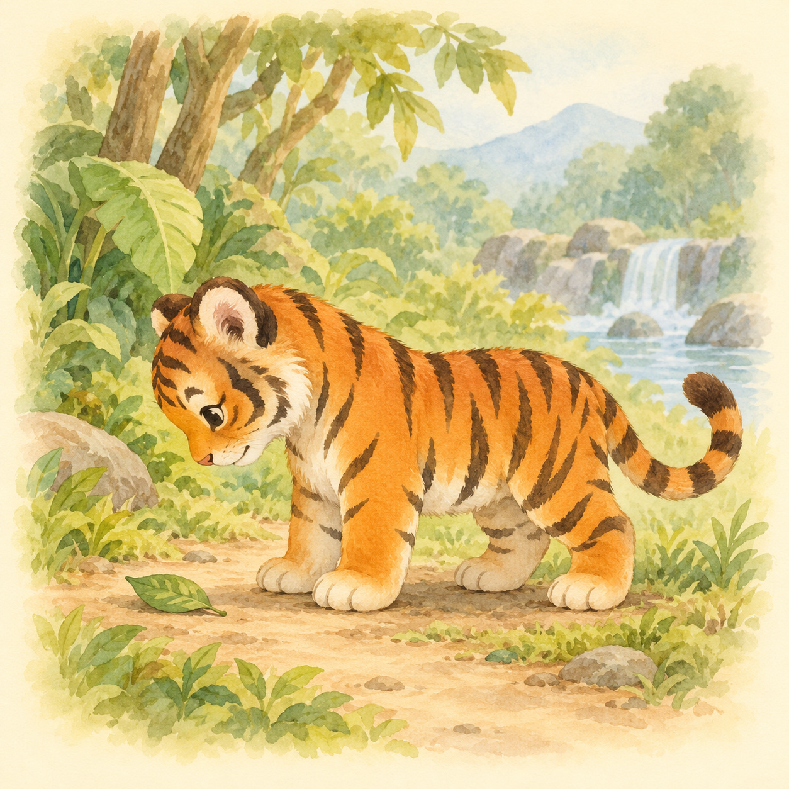
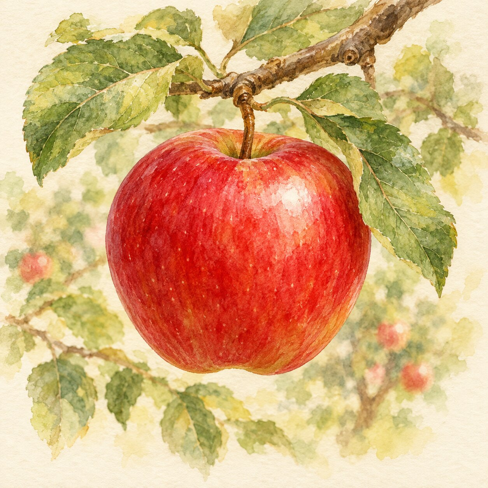
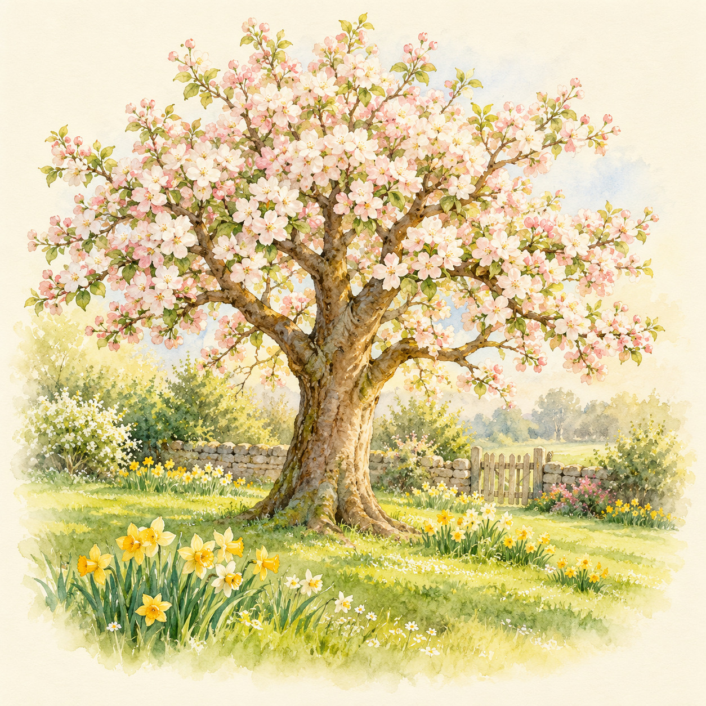

<p align="center">
  
</p>

# Jungle Academy

A gentle place for little ones to explore words, numbers and pictures. Jungle
Academy brings learning and creativity together in a warm, watercolor world for
babies and toddlers.

[**Play in your browser**](https://jungle.waozi.xyz) ·
[Download for Android or Linux](https://github.com/waozixyz/jungle/releases/latest) ·
[What's new](CHANGELOG.md)

## Little discoveries, every day

- **Picture Book:** Explore 21 illustrated books filled with animals, food,
  family, seasons and familiar things. Listen to each word or hear it spelled
  out, and turn the pages together. Discover Birds, Toys, Vehicles and Bedtime,
  hide unwanted books, and choose which books play automatically.
- **ABC + 123:** Hear letter names, explore optional illustrated word examples,
  and discover the numbers one to ten with watercolor animals. Both books
  offer Play/Pause and repeat; examples can stay visible while only the letter is spoken.
- **Animal Counting:** Count animals in clear groups of up to five and practice choosing
  the right number as the game gently adjusts its difficulty.
- **Coloring Book:** Choose a scene, add dinosaurs, animals, people and objects,
  and make a picture with crayons. Save your creations, write a story, and
  export or print them.
- **Jigsaw Puzzles:** Put together three new watercolor scenes in six sizes,
  from 4 to 64 interlocking pieces. Play alone or take turns together, peek at
  the picture, sort edge pieces and come back to your saved puzzle.

## A look inside

<p align="center">
  
  
  
</p>
<p align="center"><em>Picture Book illustrations: animals · food · seasons</em></p>

## Made for young explorers

Soft colors, friendly illustrations and quiet sounds make room for discovery.
Children can tap, swipe or use a mouse and keyboard; a shared back button and
sound control help keep the experience simple.

Choose **English, Deutsch or Español** from the title screen. Picture Book,
letters and numbers include spoken narration in all three languages. Coloring
Book keeps your work when you leave, and saved pictures can be opened again.
Browser saves stay in that browser.

## Build and contribute

Jungle Academy is open source, made with [Ziran](https://github.com/ziranlang/ziran)
and [Kryon](https://github.com/kryonlabs/kryon).

```sh
make
make run
make test
```

See the [detailed guide](docs/guide.md) for dependencies, controls, builds,
tests, artwork and deployment. Jungle's code is BSD 3-Clause; see
[LICENSE](LICENSE) and the guide for artwork and font attribution.
