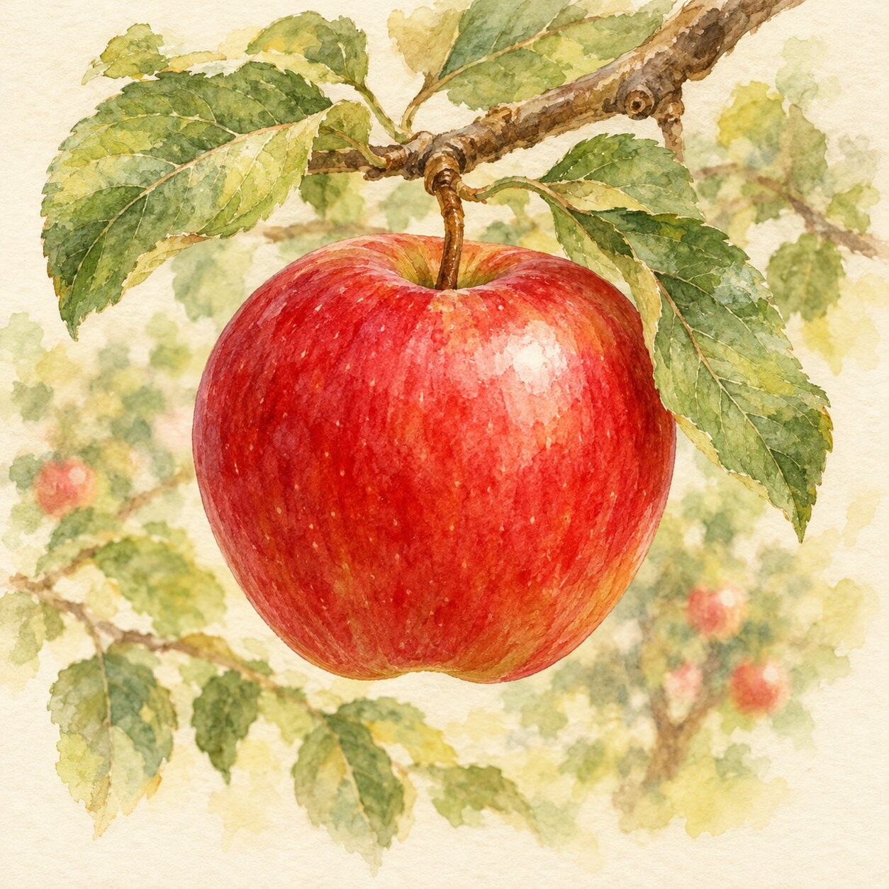
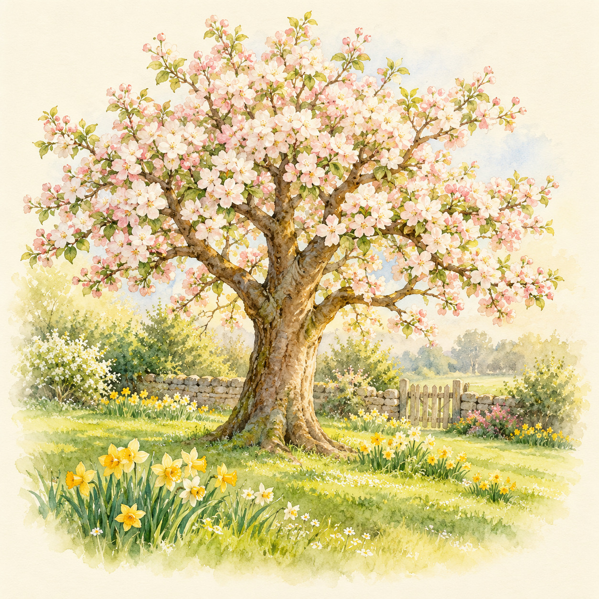

<p align="center">
  
</p>

# Jungle Academy

A gentle place for little ones to explore words, numbers and pictures. Jungle
Academy brings learning and creativity together in a warm, watercolor world for
babies and toddlers.

[**Play in your browser**](https://jungle.waozi.xyz) ·
[Download for Android or Linux](https://github.com/waozixyz/jungle/releases/latest) ·
[What's new](CHANGELOG.md)

## Little discoveries, every day

- **Picture Book:** Explore 41 illustrated books filled with animals, food,
  family, seasons, vacation, sports, the beach, weather and feelings. Learn hot
  and cold, wet and dry, tired and rested through gentle scenes. Listen to each word or hear it spelled
  out, and turn the pages together. Discover Birds, Toys, Vehicles and Bedtime,
  hide unwanted books, and choose which books play automatically. New books
  explore tropical fruits, gardening, school, water animals, drinks and everyday
  actions, desert animals, insects and people at work. Across 435 pages, every
  subject appears only once; Sports now includes
  badminton, and Actions includes cooking, cleaning, washing hands and more. Every book has
  at least ten pages; Farm Animals and Pets are separate, and Farm explores
  tractors, barns and tools under Home.
- **ABC + 123:** Hear letter names, explore optional illustrated word examples,
  and discover the numbers one to twenty with watercolor animals. Both books
  offer Play/Pause and repeat; examples can stay visible while only the letter is spoken.
- **Animal Counting:** Count animals in clear groups of five. Follow the gentle
  automatic progression, choose a range up to five, ten or twenty, or try simple
  addition and subtraction within five.
- **Coloring Book:** Choose from 26 scenes, including six Places and six Adventures,
  add dinosaurs, animals, people and objects,
  then move, resize and freely rotate each stencil before pressing Place.
  Make a picture with crayons. Erase individual newly placed objects while
  keeping the rest of the picture. Save your creations, write a story, and
  export or print them.
- **Little Piano (5+):** Play a fixed 37-key C3–C6 keyboard with the same quiet,
  accurately tuned notes for every song. Tap the song title to choose among five
  public-domain children's melodies. Follow a real treble score with only the
  current lyric line below it. Optional lessons play a short phrase for your child
  to repeat, with a filling bar showing how long to hold each key and when to
  let go. Practice, Listen and Free play remain available.
- **Jigsaw Puzzles:** Put together three new watercolor scenes in six sizes,
  from 4 to 64 interlocking pieces. Play alone or take turns together, peek at
  the picture, sort edge pieces and come back to your saved puzzle.
- **Shapes & Sorting (2+):** Watch a hand press, drag and release a matching shape,
  then explore colors and sizes.
- **Matching Pairs (2+):** Begin with two visible pairs; try hidden cards and
  puzzles with up to ten pairs when ready.
- **Hide & Seek (2+):** Look for completely hidden friends in four house and yard
  scenes. Explore natural hiding places and discover each animal for yourself.
- **Music Room (2+):** Tap illustrated drums, a shaker and a bell around a
  watercolor music room, then try copying short rhythms.

## A look inside

<p align="center">
  
  
  
</p>
<p align="center"><em>Picture Book illustrations: animals · food · seasons</em></p>

## Made for young explorers

Soft colors, friendly illustrations and quiet sounds make room for discovery.
Children can tap, swipe or use a mouse and keyboard; a shared back button and
sound control help keep the experience simple.

Choose **English, Deutsch or Español** from the title screen. Picture Book,
letters and numbers include spoken narration in all three languages. Coloring
Book keeps your work and up to eight undo steps when you leave, and saved
pictures can be opened again.
Browser saves stay in that browser.

Narration uses Ogg Vorbis. The browser edition needs a modern browser with
Vorbis support, including Safari 18.4 or later.

## Build and contribute

Jungle Academy is proprietary, made with the open-source [Ziran](https://github.com/ziranlang/ziran)
and [Kryon](https://github.com/kryonlabs/kryon).

```sh
make
make run
make test
```

See the [detailed guide](docs/guide.md) for dependencies, controls, builds,
tests, artwork and deployment. See Jungle's proprietary
[LICENSE](LICENSE) and the guide for artwork and font attribution.

### Build on Luna from the desktop

With the pinned `luna-laptop` SSH alias configured, run:

```sh
python3 scripts/remote_build.py --setup --launch  # first Debian setup, build, open
make remote-run                               # subsequent debug builds and open
make remote-debug                             # build only
```

This synchronizes current Git-visible files, including uncommitted changes,
from Jungle, Ziran, Kryon, Mingcute and locked source dependencies into canonical
`~/Projects` organization folders. Existing desktop package-cache sources are
used only when their exact locked revision is available. Before transfer, it
captures working file bytes into a disk archive in desktop `work/remote-build/`,
with SHA-256 hashes of those captured bytes, revisions and capture start/end times.
Capture spans that time window; later desktop edits are included in the next
invocation and do not invalidate this build. Only changed captured files transfer.
It verifies the manifest before building, refuses remote edits or conflicting
private files, and preserves unrelated files.
Previously synchronized source deletions move into Jungle's `backup/`.
Build outputs, private configuration, credentials and `.git` are never copied.
Source revision and content receipts live in `work/remote-build/` on the target.
Each canonical repository receives the exact shallow Git HEAD and its tree,
then keeps the synchronized current edits. No clone, checkout or network Git
fetch is used; package resolution has Git network protocols disabled.

`--setup` downloads Debian prerequisites into Jungle's `work/remote-build/sysroot`
without sudo or system installation; Python 3, Make, GCC, binutils and APT
must already be available. Builds install/reuse Harmony's supported
`build-queue`, use two jobs within a systemd user scope capped at two CPU cores,
6 GB RAM, 512 MB swap and 128 tasks, and produce `build/app/jungle` with debug symbols.
Luna must have an active graphical login to launch. Each launch opens a new
instance and preserves existing apps and saves; a live process is verified
after launch. Use `scripts/launch-luna-jungle` to open the last verified build.

Another pinned Debian SSH target can use the same workflow, for example
`make remote-run REMOTE_HOST=thinkpad.local`, with its own canonical Projects
folder, prerequisites and graphical login. Use `REMOTE_FLAGS=--setup` for
first-time setup, or `python3 scripts/remote_build.py --host HOST --sync-only`
to synchronize without building. No desktop build outputs are transferred.
Run `python3 scripts/remote_build_test.py` for the local synchronization tests.
